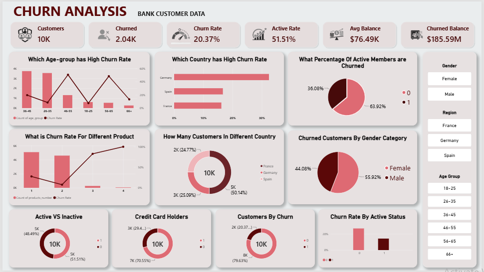
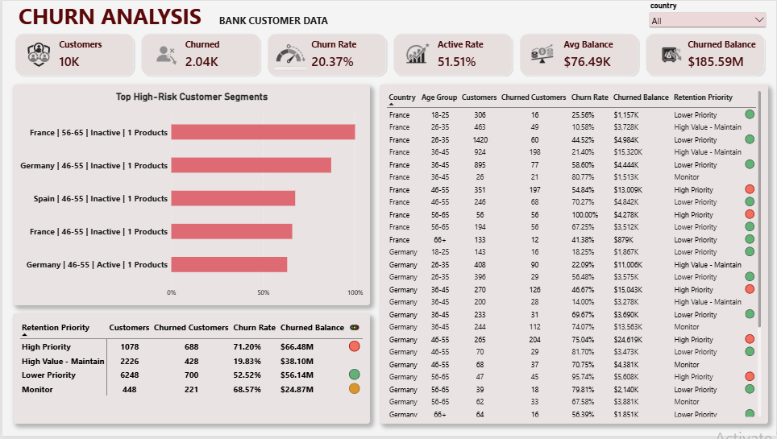

# Bank Customer Churn Analysis

An end-to-end data analytics project exploring bank customer churn using **Python, SQL (PostgreSQL), and Power BI**. The project measures churn, compares customer segments, summarizes the balance associated with churned customers, and identifies areas for further retention investigation.

> **Scope note:** This is descriptive analysis of a static customer snapshot. It does not predict who will churn in the next 30 days, prove the causes of churn, or estimate lost revenue/profit.

## Dashboard Preview

### Page 1 — Customer Churn Overview



Summarizes the customer base and compares observed churn across age groups, countries, product counts, activity status, and other customer characteristics.

### Page 2 — Retention Opportunities



Highlights customer segments for further investigation, showing customer counts, churned customers, churn rates, churned customer balance, and retention-priority labels.

**Important:** The screenshot links above assume the repository has a folder named `dashboard_screenshots` with these exact filenames. GitHub paths are case-sensitive. If your existing folder or screenshot names differ, update the paths in this README to match them.

## Business Problem

The bank needs to understand:
- How large is the observed churn problem?
- Which customer segments have higher churn rates?
- How do churn patterns vary by age, geography, activity, product count, and financial attributes?
- How much recorded balance belongs to customers who have already churned?
- Which segments should be investigated first for retention initiatives?

## Project Objectives

1. Measure overall churn using clear KPIs.
2. Compare churn across demographic, geographic, product, engagement, and financial segments.
3. Use SQL to answer repeatable business questions.
4. Build a Power BI report that communicates the findings.
5. Recommend follow-up analyses without making unsupported causal claims.

## Tools & Technologies

| Tool | Purpose |
|---|---|
| Python / Pandas / Jupyter Notebook | Data inspection, preparation checks, and exploratory data analysis |
| PostgreSQL / SQL | KPI calculations, aggregations, filtering, and segmentation |
| Power BI | KPI cards, charts, filters, and retention-opportunity reporting |
| GitHub | Version control and project documentation |

## Dataset

The project uses a Kaggle bank customer churn dataset with these fields:

`customer_id`, `credit_score`, `country`, `gender`, `age`, `tenure`, `balance`, `products_number`, `credit_card`, `active_member`, `estimated_salary`, `churn`.

`churn = 1` represents a customer marked as churned; `churn = 0` represents a customer not marked as churned in the dataset.

## Key Results

Results from the supplied analysis of 10,000 customer records:

| Metric | Result |
|---|---:|
| Total customers | 10,000 |
| Churned customers | 2,037 |
| Overall churn rate | 20.37% |
| Average credit score | 650.53 |
| Average balance | 76,485.89 |
| Average estimated salary | 100,090.24 |
| Churned customer balance | Approximately 185.59M |

Use the currency convention from the source dataset/report. **Churned customer balance** is the sum of recorded balances for customers marked as churned; it is not the same as lost revenue or profit.

### Main Findings

- **Churn is material:** 2,037 of 10,000 customers are marked as churned.
- **Activity is associated with churn:** the supplied analysis found a higher observed churn rate among inactive customers than active customers.
- **Age groups differ:** customers aged 46–55 and 56–65 showed the highest observed churn rates in the analysis.
- **Geography differs:** Germany had a higher observed churn rate than France and Spain in the supplied results.
- **Product-count patterns are non-linear:** two-product customers showed lower churn than one-product customers, while three- and four-product groups had high rates but much smaller populations.
- **Credit-card ownership showed little separation:** observed churn rates were similar for customers with and without a credit card.
- **Salary bands showed relatively similar churn rates** in the SQL results.

These are descriptive associations. They do not establish why customers churned or prove that an attribute causes churn.

## Project Workflow

### 1. Python — Exploratory Data Analysis

The notebook was used to:
- Inspect dataset shape, columns, data types, missing values, and customer ID uniqueness.
- Review distributions and prepare analysis groups such as age bands.
- Compare churn across demographics, geography, activity, product count, and financial attributes.
- Calculate the recorded balance associated with churned customers.
- Summarize the most relevant findings for business analysis.

### 2. SQL — Business Analysis

SQL questions covered:
- **Basic KPIs:** total customers, churned customers, churn rate, averages, and active-member percentage.
- **Demographics:** churn by gender and age group.
- **Geography:** churn rate and customer distribution by country.
- **Products:** churn by product count and credit-card ownership.
- **Engagement:** active versus inactive customers, including combinations with age, country, and product count.
- **Financial analysis:** churn by credit-score, balance, and salary bands; churned customer balance.
- **Advanced segmentation:** combinations of country, age group, activity status, and product count.

### 3. Power BI — Reporting

The report contains two pages:
- **Customer Churn Overview:** communicates the scale of churn and how it varies across customer groups.
- **Retention Opportunities:** helps compare segment size, churn rate, and churned customer balance to guide further investigation.

## Business Recommendations

1. **Investigate inactive customers.** Compare their churn patterns across country, age, product count, and balance. With time-based activity data, test whether declining engagement precedes churn.
2. **Review customers aged 46–65.** Examine their product relationships, activity, needs, and balance distribution rather than assuming age itself explains churn.
3. **Investigate the Germany churn gap.** Compare similar customer profiles across countries to see whether the difference remains after segmentation.
4. **Examine product relationships.** Review one-product customers and investigate the small three- and four-product groups before drawing conclusions from their high churn percentages.
5. **Prioritize segments using multiple measures.** Consider churn rate, customer count, and churned balance together. Document priority thresholds and use a minimum segment-size rule.
6. **Test retention initiatives.** Measure campaign outcomes against an appropriate comparison group before concluding that an intervention reduces churn.

## Limitations

- The dataset is a static snapshot and does not include churn dates or monthly customer history.
- It cannot identify customers likely to churn in the next 30 days.
- Descriptive patterns do not establish causation.
- Churned customer balance is not lost revenue, profit, or predicted future exposure.
- Retention-priority labels are heuristic business rules, not validated churn probabilities.
- Very small segments can show extreme churn rates, so customer counts should be reviewed alongside percentages.

## Repository Structure

All notebook, SQL, CSV, and Power BI files can remain in the repository root, with logos and dashboard screenshots in their own folders. A suggested structure is:

```text
bank-customer-churn-analysis/
├── README.md
├── Customer_churn_analysis(EDA).ipynb
├── Customer_churn_analysis.sql
├── Bank Customer Churn Prediction.csv
├── customer_churn_report.pbix
├── logos/
│   └── ...
└── dashboard_screenshots/
    ├── customer_churn_overview.png
    └── retention_opportunities.png
```

This is an example. Keep your existing file names if preferred, but update the screenshot links at the top of this README to match the actual folder and image names. GitHub supports relative image links; paths and capitalization must match exactly.

## How to Reproduce the Analysis

1. Obtain the dataset from its original Kaggle source, respecting its license and terms.
2. Open and run the Python `.ipynb` notebook.
3. Load the prepared dataset into PostgreSQL and run the `.sql` scripts.
4. Open the `.pbix` report in Power BI Desktop. If prompted, update the data-source path or database connection.
5. Compare key counts and rates across Python, SQL, and Power BI to ensure the measures reconcile.


## Conclusion

This project demonstrates an end-to-end descriptive analytics workflow: **Python for discovery, SQL for structured business analysis, and Power BI for reporting**. The analysis identifies churn differences across customer segments and helps frame where the bank should investigate retention opportunities. The next step is to validate those opportunities with longitudinal data and measured retention outcomes.
